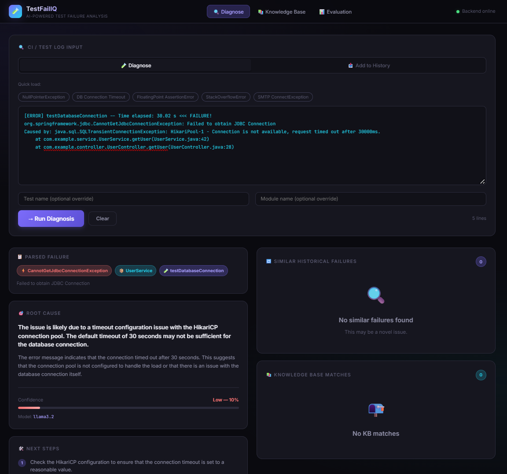
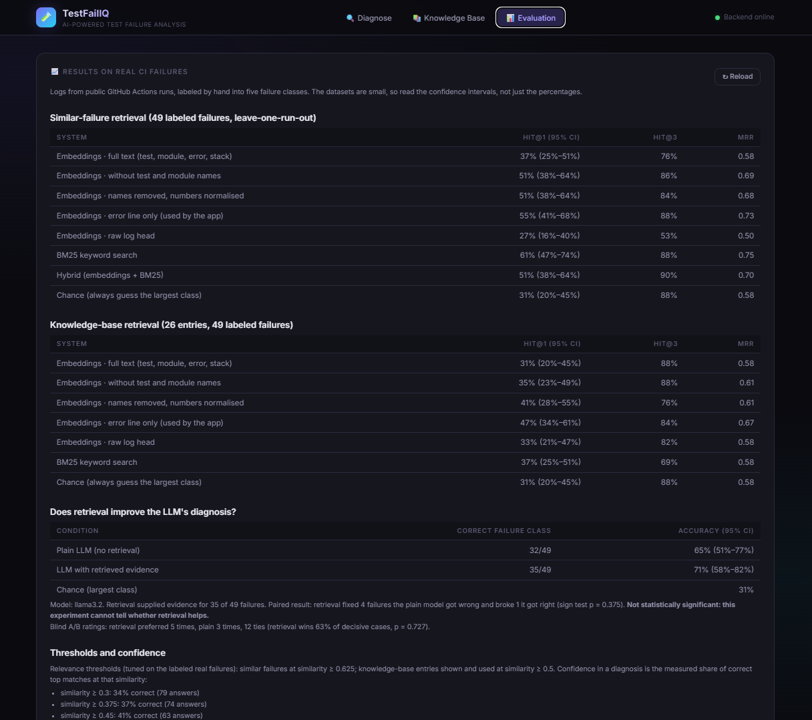
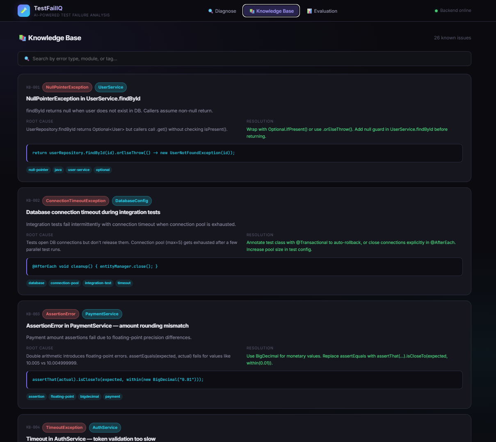

# TestFailIQ: AI-assisted test failure investigation

[](https://github.com/Prajwalwho/TestFailIQ/actions/workflows/ci.yml)

Paste a failed CI log and get a failure class, similar past failures, a matching known issue, and a suggested root cause with next steps. The application combines a log parser, sentence-transformer embeddings, FAISS, a knowledge base for retrieval, and an LLM for diagnosis generation.

## Live Demo

- **Frontend:** [TestFailIQ](https://test-fail-iq.vercel.app)
- **Backend health:** [API health check](https://testfailiq-backend.onrender.com/api/health)

The frontend is deployed on Vercel and the API on Render. The backend health endpoint reports the service status and indexed failure count.

**Current deployment status:** The hosted application is responding and historical failure retrieval is working. However, the diagnosis screenshot currently reports `KB fallback — Ollama/LLM unavailable`. The hosted LLM integration has not yet been verified successfully, so generated diagnoses should not be assumed to come from the LLM.

## Screenshots

### Diagnosis

Paste a failed CI log to view parsed failure details, the suggested root cause, confidence, similar historical failures, knowledge-base matches, and next steps.



### Evaluation

View retrieval metrics on real CI failures, knowledge-base retrieval results, and the experiment comparing LLM diagnosis with and without retrieved evidence.



### Knowledge Base

Browse the known issues, their root causes, resolutions, code snippets, and searchable tags.



> **Honest summary:** This is a portfolio project evaluated on a small, hand-labeled set of real CI failures. The results section reports what was measured, including where retrieval did **not** clearly help.

## How it works

```text
CI log
  │
  ▼
Parser ──► error type, message, test name, module, stack trace
  │
  ▼
Embedding (MiniLM, error line)
  │
  ├──────────────────┐
  ▼                  ▼
FAISS: similar       Knowledge base
past failures        (26 entries)
  │                  │
  └────────┬─────────┘
           ▼
     Re-order with user feedback
     (never creates evidence)
           │
           ▼
     Prompt: log excerpt + evidence
     marked "may be unrelated"
           │
           ▼
     Local LLM (Ollama, llama3.2)
           │
           ▼
     JSON schema validation
           │
           ├── Success ──► Diagnosis
           │
           └── Ollama unavailable
               or invalid JSON
                    │
                    ▼
             Knowledge-base fallback
                    │
                    ▼
     React UI: diagnosis, calibrated confidence,
     similar failures, KB matches, feedback
```

**Deployment note:** The local Docker setup is designed to use Ollama with `llama3.2`. In the current hosted deployment, the UI reports `KB fallback — Ollama/LLM unavailable`. The fallback provides a response without confirming successful LLM generation.

Supported log formats: pytest, Jest/Vitest, Mocha, Gradle/Maven (JUnit), Go test, with generic fallbacks.

## Quick start

### Docker

Ollama runs on the host, so install it and pull the model first. Without Ollama, the app still works through its knowledge-base fallback and indicates this in the Model line.

```bash
ollama pull llama3.2
docker compose up --build
```

The first build can take several minutes.

Open the application at [http://localhost:8080](http://localhost:8080).

The Docker demo index contains only the synthetic logs; the real-data results shown in the Evaluation tab ship as committed JSON files.

### Local development

Start the backend:

```bash
cd backend
pip install -r requirements-dev.txt
python main.py
```

The API runs on port `8000`.

In a separate terminal, start the frontend:

```bash
cd frontend
npm install
npm run dev
```

The frontend runs on port `5173`.

### Tests

Run the backend test suite:

```bash
cd backend
python -m pytest tests -q
```

The previously verified test suite has 56 passing tests. CI also runs the frontend build and Docker build. Run the commands above to confirm the current state of your checkout.

## Results on real CI failures

### Dataset

The evaluation uses 79 failed-job logs from public GitHub Actions runs, hand-verified. Of these, 49 are labeled into four failure classes:

- Assertion failure: 13
- Build/compile: 15
- Environment/infra: 15
- Runtime exception: 6

The other 30 are real failures with no clear class and act as distractors. A fifth class (dependency/import) has knowledge-base entries but no labeled logs, so it cannot be evaluated.

One person performed the labeling. A keyword auto-labeler was only 35% accurate on audit, so **only hand-verified labels are used**.

### Similar-failure retrieval

Leave-one-run-out evaluation: a log never retrieves anything from its own CI run.

| Method | Hit@1 | Hit@3 | MRR |
|---|---:|---:|---:|
| Chance (always the largest class) | 31% | 88% | 0.58 |
| Embeddings, full text | 37% (25–51%) | 76% | 0.58 |
| Embeddings, test and module names removed | 51% (38–64%) | 86% | 0.69 |
| Embeddings, names removed and numbers normalised | 51% (38–64%) | 84% | 0.68 |
| **Embeddings, error line only (used by the app)** | **55% (41–68%)** | **88%** | **0.73** |
| BM25 keyword search | 61% (47–74%) | 88% | 0.75 |
| Hybrid (embeddings + BM25) | 51% (38–64%) | 90% | 0.70 |

Values in parentheses are 95% Wilson confidence intervals.

With 49 queries, BM25 and embeddings are **statistically tied**. Hit@3 is nearly uninformative with four classes because chance already scores 88%, so Hit@1 is the more useful metric to examine.

### Knowledge-base retrieval

The knowledge base contains 26 entries and was evaluated against 49 labeled failures using error-line embeddings.

- Embeddings, error line only: Hit@1 **47% (34–61%)**
- BM25 keyword search: Hit@1 **37%**
- Chance baseline: **31%**

This is a weak signal, which is why KB entries are supplied to the LLM only above a precision-checked relevance threshold.

### Does retrieval improve the LLM's diagnosis?

The same prompt, model, seed, and temperature of 0 were used with and without retrieved evidence. The model also predicts the failure class, which is compared with the hand-labeled class.

| Condition (49 failures) | Correct class | Accuracy (95% CI) |
|---|---:|---:|
| Plain LLM, no retrieval | 32/49 | 65% (51–77%) |
| LLM with retrieved evidence | 35/49 | 71% (58–82%) |
| Chance (largest class) | — | 31% |

Retrieval fixed 4 failures and broke 1. The paired sign test gave `p = 0.375`.

**The difference is not statistically significant; this experiment cannot rule out zero effect.**

In 20 blind A/B ratings of diagnosis usefulness:

- Retrieval was preferred 5 times.
- The plain model was preferred 3 times.
- 12 comparisons were ties.

Synthetic held-out sets, written by me, score higher—around 90–100% Hit@1 for embeddings. They are not evidence of real-world performance and are shown separately in the app.

## What I learned

- **Embedding only the error line beat embedding the whole parsed record.** Hit@1 was 55% versus 37%; test names, class names, and paths added noise.
- **Thresholds should come from data, not intuition.** My first rule supplied the LLM with a knowledge-base entry that was wrong 66% of the time. Adding a precision floor improved this. The knowledge base is now used as evidence only when at least 40% of matches at that threshold were correct.
- **Confidence is calibrated.** It is the measured share of correct top matches at that similarity, using isotonic regression over labeled data, rather than a raw cosine similarity score.
- **Feedback only re-orders relevant results.** A thumbs-up can never create evidence; it only re-orders results that have already passed the relevance threshold.
- **A strong baseline matters.** A 3B local model alone already classifies 65% of failures correctly, leaving retrieval limited room to improve the result.

## Limitations

- **Small dataset:** 49 labeled failures, labeled by one person with no inter-annotator agreement, drawn from large open-source projects that may not resemble your projects.
- **Knowledge-base bias:** The KB was written by me using general CI knowledge and patterns seen while labeling, so its results are somewhat optimistic.
- **Limited ground-truth fixes:** Real logs have no written fixes. Past failures carry a hand-labeled class hint instead of a resolution, so the ablation mostly measures classification help.
- **Parser coverage on the 79 real logs:**
  - Error type: 78/79
  - Message: 78/79
  - Test name: 52/79
  - Module: 60/79
- **Confidence is not diagnosis correctness:** Retrieval confidence describes how often similar matches were right, not whether the generated diagnosis is right.
- **Hosted deployment:** The frontend is deployed on Vercel and the backend on Render. The hosted backend currently falls back to the knowledge base because Ollama/the LLM is unavailable. Hosted LLM generation and its latency have not yet been verified.
- **Security:** The deployed service's authentication, rate limiting, request-size limits, and protection against public misuse should be assessed separately from the local development setup. Do not treat deployment alone as evidence that the API is production-hardened.
- **Local performance:** LLM calls took 25–30 seconds on CPU in the previously tested local setup. Hosted latency may differ and has not been established.
- **Persistence:** Local persistence uses FAISS, pickle metadata, and JSON files without locking. Pickle files must only be loaded from trusted locations.
- **Log availability:** Raw log excerpts are third-party content and are not redistributed. `labels.csv` and `manifest.json` list every source run; GitHub retains logs for only about 90 days.

## API

| Method | Endpoint | Purpose |
|---|---|---|
| GET | `/api/health` | Health and index size |
| POST | `/api/diagnose` | Parse, retrieve, and generate; returns a `diagnosis_id` |
| POST | `/api/feedback` | Mark a diagnosis correct or incorrect |
| POST | `/api/ingest` | Add a failure to the index |
| GET | `/api/failures` | List indexed failures |
| GET | `/api/failures/{id}` | Retrieve a specific indexed failure |
| GET | `/api/knowledge` | Knowledge-base entries |
| GET | `/api/metrics` | Feedback counts |
| GET | `/api/eval-results` | Evaluation results |
| GET | `/api/eval-real` | Real-data evaluation results (read-only) |

## Repository layout

```text
backend/
  main.py, routes_eval.py
  ingestion/
    log_parser.py, embedder.py
  storage/
    faiss_store.py, knowledge_base.py,
    diagnosis_store.py, feedback_signal.py
  rag/
    retriever.py, ranking.py, generator.py, confidence.py
  evaluation/
    run_eval.py, run_real_eval.py, run_real_kb_eval.py,
    tune_thresholds.py, run_rag_ablation.py, stats.py
  data/
    knowledge_base.json, thresholds.json, eval_*.json,
    real_logs/ (labels, manifest)
  tests/

frontend/                         React + Vite
                                  Diagnose, Knowledge Base,
                                  Evaluation tabs

docker-compose.yml
.github/workflows/ci.yml
docs/screenshots/
  diagnose.png
  evaluation.png
  knowledge.png
```

## Reproducing the evaluation

Run these commands from the `backend` directory:

```bash
python evaluation/run_eval.py
python evaluation/run_real_eval.py
python evaluation/run_real_kb_eval.py
python evaluation/tune_thresholds.py
python evaluation/run_rag_ablation.py
```

The scripts respectively run the synthetic held-out evaluation, real-data retrieval evaluation, knowledge-base retrieval evaluation, threshold tuning, and RAG ablation. The real-data scripts require the relevant log excerpts; the RAG ablation also requires Ollama to be running.

New real logs can be collected with `python data/collect_real_logs.py` (requires a GitHub token with `public_repo` scope) and labeled using its `--label` mode.
